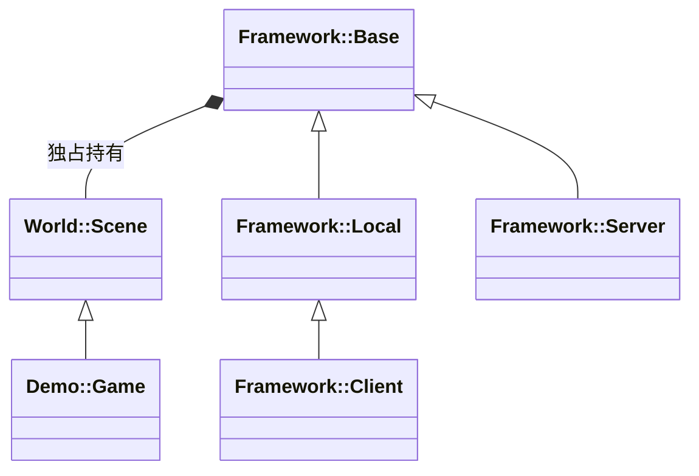

# Framework

游戏由 World::Scene 的派生类实现，Framework::Base 独占持有该实例，并通过 World::Scene 接口驱动它。
Framework 集成 World、Schema 和 Graphics，负责运行状态、资源加载策略和场景到渲染数据的转换。
Local 负责 GLFW 初始化、窗口及 OpenGL 上下文；宿主负责 PhysFS 初始化及挂载、事件循环和计时。

## 对象与所有权

游戏实现与运行角色是两条独立关系：



World::Scene 提供实体组件和场景更新能力；具体 Game 派生类构建场景并实现游戏规则。
Base 管理实例所有权及运行状态，Local/Client/Server 增加运行环境的能力。
游戏规则放在 Scene 派生类的 onUpdate 等方法中，不放入 Framework 的更新钩子。
不增加独立 Game 基类、Application 基类或会话对象。

运行角色：

```text
Base
├── Local              Standalone：本地输入、渲染、声音
│   └── Client         本地能力 + 网络更新接口
└── Server             网络更新接口，无 Graphics/OpenGL 依赖
```

| 对象 | 服务 | 成员数据 |
| --- | --- | --- |
| Base | 加载、播放、暂停、重置、卸载、资源同步、更新 Scene | 状态、Scene 工厂、独占 Scene、Model 描述缓存及待提交缓存 |
| Local | 创建窗口与 GL 上下文、显示资源加载、提取相机/模型/灯光、绘制、输入/声音更新接口 | GLFW 生命周期守卫、Window、Renderer、View、Material 描述、独占 GPU Mesh/Texture 缓存及各自待提交缓存 |
| Window | 持有 GLFW 窗口及其 GL 上下文、激活上下文、提供 Graphics::Target | GLFWwindow*，负责销毁窗口 |
| Client | 输入之后调用网络更新接口 | 无额外状态 |
| Server | Scene 更新之前调用网络更新接口 | 无额外状态 |

Standalone 直接使用 Local。配置通过所属对象的方法设置：`local.renderer()` 配置渲染器，
`local.view()` 设置环境光和清屏颜色。不增加全局 Options、资源管理器或网络连接占位对象。

World::Model 只保存 `std::filesystem::path source`，指向 VE Model 文件。
World 不再定义显示资源 Mesh/Material，文件结构由 Schema 描述，GPU 对象由 Graphics 提供。
Framework 不调用 World::Physics。Scene 自己管理物理运行时的引用计数和生命周期；
最后一个 Scene 销毁后才关闭物理运行时，宿主无需显式初始化物理系统。

## 状态机

| 方法 | 条件和结果 |
| --- | --- |
| load(factory) | Idle → Loading → Ready；工厂创建 Scene，同步加载资源 |
| play() | Ready / Paused → Playing |
| pause() | Playing → Paused，保留运行进度 |
| stop() | Ready / Playing / Paused → Loading → Ready；重新调用工厂，复用资源缓存 |
| unload() | 销毁场景及资源 → Idle；Idle 中重复调用无操作 |
| synchronizeResources() | 已加载状态 → Loading → 原状态；加载新增资源 |
| update(elapsed) | Idle 无操作；Ready / Playing / Paused 执行更新接口，仅 Playing 更新 Scene |
| scene() | 返回当前 Scene；Idle / Loading 中抛出异常 |

非法状态调用抛出 `std::logic_error`，负时间抛出 `std::invalid_argument`。
Loading 禁止生命周期操作重入。工厂只负责创建或重建游戏 Scene，不承担游戏更新逻辑。
工厂必须可重复调用且返回非空对象，捕获的数据须保持有效。Base 接收工厂返回的 unique_ptr，保存实例并负责销毁。
首次加载失败回到 Idle；重置失败保留旧 Scene 和状态；同步失败保留已有缓存。
准备阶段产生的 CPU/GPU 资源单独保存，全部成功后通过映射节点合并提交，不复制已有资源内容。
错误包含读取失败的资源路径，不使用占位资源掩盖错误。

资源文件在同一实例内按规范化的 PhysFS 虚拟路径缓存，直至 unload。
stop 会重建 Scene 和内部物理状态；文件内容变化不会自动刷新已加载路径。
Scene 引用在 stop/unload 后失效，调用方须重新取得 Scene 及实体句柄。

## 资源路径和加载

PhysFS 初始化及挂载由宿主完成，所有 Framework 和 PhysFile 对象销毁后才能关闭 PhysFS。
多个实例共享挂载表。Framework 使用 PhysFile 的 RAII 文件生命周期，通过 Schema 读取数据。

Model 的 source 相对 PhysFS 根目录；Part 的 mesh/material 路径相对 Model 文件所在目录；
Material 的纹理路径相对 Material 文件所在目录。缓存内保存解析后的根目录相对路径。
路径禁止绝对路径、`..`、NUL、反斜杠和冒号。组件路径允许 `.` 并进行规范化，
文件内部路径遵守 [Schema](../../Schema/docs/Schema.md) 的严格格式。

Base/Server 仅读取 Model 描述，不加载显示用 Mesh/Material/Texture。
Local 加载完整依赖，转换并上传 GPU Mesh，以及所有声明的纹理；Schema Texture 已预乘 alpha，
通过 `Texture::uploadPremultiplied` 直接上传。Mesh 顶点/索引和纹理像素在上传后释放，
Local 只长期保留绘制仍需使用的 Model/Material 描述与 GPU 资源，其中 Model 描述由 Base 保存。
当前 Graphics 使用 albedo、albedoTexture、lit 和 alphaMode；其余 PBR 参数及法线/金属粗糙度贴图暂不参与着色。

修改组件路径或添加新 Model 后须显式调用 `synchronizeResources()`。
普通 update/render 不读取资源文件，也不上传模型和纹理；Renderer 仍会按目标尺寸调整帧缓冲。
资源不会因实体移除而提前释放，不提供异步加载、热重载、全局缓存或 LRU。

扩展资源加载时，`onLoadResources` 调用父类并只准备资源；
`onCommitResources() noexcept` 提交准备结果，`onDiscardResources() noexcept` 丢弃准备结果，
`onUnloadResources() noexcept` 释放资源。扩展类拥有的资源也须在其析构阶段完成清理。

## 更新和渲染时序

`update` 顺序：`onBeforeUpdate` → Playing 时 `Scene::update` → `onAfterUpdate`。
Local 前置输入、后置声音；Client 输入之后调用网络接口；Server 前置调用网络接口。
Ready/Paused 中仍处理这些接口。网络、输入、声音仅提供可覆盖方法，无具体后端实现。
Scene 内部先更新游戏逻辑再更新物理；零时间仍执行游戏逻辑，但跳过物理步进。
宿主提供时间间隔，不增加固定步长或追帧策略。

`Local::render(target, camera)` 在 Ready/Playing/Paused 可用。
相机实体必须属于当前 Scene，并且恰好具有一种 PerspectiveCamera/OrthographicCamera 组件。
相机视图矩阵为实体变换乘相机 offset 的逆；投影直接使用相机组件。
相机矩阵须有限且可逆，PerspectiveCamera 的宽高比由宿主更新。

每次 render 执行 View begin → 设置相机 → 添加模型与灯光 → end → Renderer render。
没有 Inherent 组件的实体默认可见；有该组件的模型/灯光必须同时 enabled 和 visible。
缺少实体 Transform 时使用单位矩阵。模型最终矩阵为实体变换乘 Part 仿射矩阵，保留剪切。
灯光 offset 同样叠加实体变换，方向转换到世界空间，距离和角度保留组件值。
View::end 完成矩阵准备和排序，Renderer 消费 const View。

GPU Mesh/Texture 由 unique_ptr 持有，缓存增长不会改变对象地址。
Local 卸载时先清空 View 的借用引用，再释放 GPU 对象；GPU 缓存先于 Renderer 销毁，随后销毁 Window，最后关闭 GLFW。
Local 在资源加载、渲染和清理时激活自己的上下文。构造中途失败也会释放已取得的资源。
Local/Client 须在主线程创建、使用和销毁；当前按一个 Local/Client 管理 GLFW 进程生命周期，
不支持同时存在多个 Local 实例，也不要由外部提前调用 glfwTerminate。
通过 renderer() 或自行创建 GPU 资源时，调用方仍须保证正确的上下文，并在 Local 销毁前释放外部 GPU 资源。

## 使用与宿主入口

宿主通过所选游戏自己导出的 `<Volcano/Game.h>` 使用 `volcanoCreateGame()`。
Demo 的入口头文件位于 `games/Demo/include/Volcano/Game.h`，场景构建和游戏逻辑均放在 games/Demo，暂不使用 JSON Manifest。
该函数由选中的游戏实现，返回 `std::unique_ptr<World::Scene>`；声明不属于 World 或 Framework。
例如 Demo 返回 `std::make_unique<Volcano::Demo::Game>()`，Demo::Game 派生于 World::Scene。

在 PhysFS 已挂载后，直接构造 Local；不再传入 GL 函数解析器，也无需宿主初始化 GLFW：

```cpp
#include <Volcano/Game.h>
#include <Volcano/Framework/Local.h>

Framework::Local local(800, 600, "VolcanoDemo");
local.load(volcanoCreateGame);
local.play();
// 宿主每帧：处理事件、更新相机宽高比，然后：
local.update(elapsed);
local.render(cameraEntity);
glfwSwapBuffers(local.window().handle());
```

Local::window() 提供窗口，构造参数设置窗口尺寸及标题；窗口尺寸查询使用实际 framebuffer 像素尺寸。
`render(camera)` 输出到自己的窗口，`render(target, camera)` 保留向 FrameBuffer 等目标输出的能力。
渲染方法不交换缓冲；宿主通过 GLFW 处理事件、控制关闭和调用 glfwSwapBuffers。
Launcher 直接实例化 Local 或 Client（`--client`），保留命令行及宿主循环。
示例宿主每帧选择第一个透视相机，若无则选择第一个正交相机；没有相机时报告错误。
Demo 提供默认相机。游戏可通过 Scene 工厂创建带 Model 路径的实体。
`--root <directory>` 指定资源挂载目录，默认当前目录。

Server 直接实例化 Framework::Server，支持相同的 `--root`，运行至 SIGINT/SIGTERM。
`--ticks N` 用于有限次无窗口启动验证，0 表示持续运行，例如：

```sh
./build/Debug/bin/VolcanoServer --root . --ticks 2
```

CMake：`Framework → World + Schema`；`FrameworkLocal → Framework + Graphics + GLFW`；Framework 核心及 Server 不依赖 GLFW。
`Game → World`，宿主链接所选 `Gameplay` 和需要的 Framework 入口；World/Framework 均不依赖具体游戏。
游戏入口及工程接入见 [Game](../../../games/Demo/docs/Game.md)。
FrameworkCheck 无需显示；FrameworkLocalCheck、FrameworkWindowCheck 需要 OpenGL 3.3 显示环境，CTest 标签为 display。
