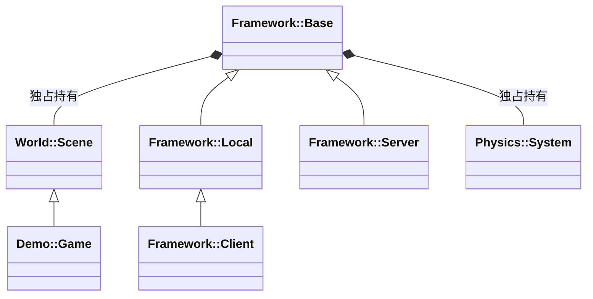

# Framework

游戏由 World::Scene 的派生类实现，Framework::Base 独占持有该实例，并通过 World::Scene 接口驱动它。
Framework 集成 World、Physics、Asset 和 Graphics，负责运行状态、资源加载策略和场景到渲染数据的转换。
Local 持有 Window，Window 负责 GLFW 初始化、窗口及 OpenGL 上下文；宿主负责 PhysFS 初始化及挂载、事件循环和计时。

## 对象与所有权

游戏实现与运行角色是两条独立关系：



World::Scene 提供实体组件和场景更新能力；具体 Game 派生类构建场景并实现游戏规则。
Base 管理实例所有权及运行状态，Local/Client/Server 增加运行环境的能力。
游戏规则放在 Scene 派生类的 onUpdate 等方法中，不放入 Framework 的更新钩子。
不增加独立 Game 基类、Application 基类或会话对象。

运行角色：

```text
Base
├── Local              Standalone：本地输入、渲染、声音
│   └── Client         本地能力 + 网络更新接口
└── Server             网络更新接口，无窗口或 GL 初始化需求
```

| 对象 | 服务 | 成员数据 |
| --- | --- | --- |
| Base | 加载、播放、暂停、重置、卸载、资源同步、更新 Scene | 状态、Scene 工厂、独占 Scene、独占 Physics::System、FIFO scheduler、顶层加载 task、进度与取消标志 |
| Local | 创建窗口与 GL 上下文、显示资源加载并挂载运行时渲染组件、驱动动态输出与渲染、输入/声音更新接口 | Window、Renderer、View、路径资源缓存及 `TextureOutput` |
| Resources（命名空间） | 单项资源默认加载与 load/get/unload/clear | 实现内部按类型和 key 索引的 weak_ptr 缓存 |
| Window | 管理 GLFW 生命周期、窗口及其 GL 上下文、激活上下文、提供 Graphics::Target | 存活窗口计数、GLFWwindow*、GL3WProcs，最后一个窗口销毁时关闭 GLFW |
| Client | 输入之后调用网络更新接口 | 无额外状态 |
| Server | Scene 更新之前调用网络更新接口 | 无额外状态 |

Standalone 直接使用 Local。配置通过所属对象的方法设置：`local.renderer()` 配置渲染器，
`local.view()` 设置环境光和清屏颜色。通用资源通过 Framework::Resources 全局接口访问；场景纹理通过 local.texture(id) 获取，绘图回调通过 local.setDrawingProvider 注册。

World::Model 保存模型路径及按材质路径指定的场景纹理覆盖。
World 不再定义显示资源 Mesh/Material，文件结构由 Asset 描述，GPU 对象由 Graphics 提供。
Physics 读取 World::RigidBody 的 VE 描述并转换为 Jolt 对象；World 不包含或链接 Jolt。
Base 为每个 Scene 创建绑定其 registry 的 Physics::System，物理句柄仅保存在 System 内部。
System 监听组件变化，在同步时校验和创建刚体；模拟结果写回 Transform。
`base.physics()` 提供重力配置和显式同步接口。卸载、重置和析构先释放 System，再销毁 Scene。
Jolt 运行时由 System 自己管理，Scene 的创建、销毁不要求初始化物理系统。
详见 [Physics](../../Physics/docs/Physics.md) 和 [RigidBody](../../World/docs/RigidBody.md)。

## 状态机

| 方法 | 条件和结果 |
| --- | --- |
| load(factory) | Idle → Loading → Ready；工厂创建 Scene，同步加载资源 |
| play() | Ready / Paused → Playing |
| pause() | Playing → Paused，保留运行进度 |
| stop() | Ready / Playing / Paused → Loading → Ready；重新调用工厂，复用资源缓存 |
| unload() | 销毁场景及资源 → Idle；Idle 中重复调用无操作 |
| synchronizeResources() | 已加载状态 → Loading → 原状态；加载新增资源 |
| update(elapsed) | 始终执行任务队列；Idle / Loading 跳过游戏更新，仅 Playing 更新 Scene 和物理 |
| scene() / physics() | 返回当前 Scene / 物理系统；要求处于已加载状态 |

非法状态、负时间和空工厂属于调用方错误，通过 `VOLCANO_ASSERT` 检查；Release 不执行这些检查。
Framework 渲染要求资源已成功加载或同步、相机实体属于当前 Scene，通过断言检查；Resources::loadXxx 先查缓存，未命中时读取并创建资源，失败通过异常报告。
资源路径、场景描述、加载失败及工厂返回空对象仍通过异常报告。
Loading 禁止生命周期操作重入。工厂只负责创建或重建游戏 Scene，不承担游戏更新逻辑。
工厂必须可重复调用且返回非空对象，捕获的数据须保持有效。Base 接收工厂返回的 unique_ptr，保存实例并负责销毁。
首次加载失败回到 Idle；重置失败保留旧 Scene、物理系统和状态；同步失败保留已有缓存。
准备阶段产生的 CPU/GPU 资源单独保存，全部成功后通过映射节点合并提交，不复制已有资源内容。
错误包含读取失败的资源路径，不使用占位资源掩盖错误。

模型资源使用规范化的 PhysFS 路径作为通用缓存 key，实际句柄由加载它的场景持有。
stop 会重建 Scene 和内部物理状态；文件内容变化不会自动刷新已加载路径。
Scene 和 Physics::System 引用在 stop/unload 后失效，调用方须重新取得 Scene 及实体句柄。

## 资源路径和加载

PhysFS 初始化及挂载由宿主完成，所有 Framework 和 PhysFile 对象销毁后才能关闭 PhysFS。
多个实例共享挂载表。Framework 使用 PhysFile 的 RAII 文件生命周期，通过 Asset 读取数据。

Model 的 source 相对 PhysFS 根目录；Part 的 mesh/material 路径相对 Model 文件所在目录；
Material 的纹理路径相对 Material 文件所在目录。缓存内保存解析后的根目录相对路径。
资源路径从 PhysFS 虚拟根定位，规范化为虚拟绝对路径；禁止 `..`、NUL、反斜杠和冒号，不能使用宿主文件系统路径。组件路径允许 `.` 并进行规范化，
文件内部路径遵守 [Asset](../../Asset/docs/Asset.md) 的严格格式。

Base/Server 仅读取 Model 描述，不加载显示用 Mesh/Material/Texture。
Local 加载完整依赖，转换并上传 GPU Mesh，以及所有声明的纹理；Asset Texture 已预乘 alpha，
通过 `Texture::uploadPremultiplied` 直接上传。Mesh 顶点/索引和纹理像素在上传后释放，
Resources 仅索引资源的弱引用；Base 保存模型描述的强引用和暂存引用，Local 保存图形资源的强引用和暂存引用。模型描述使用规范化路径共享，图形资源缓存由 Resources 按 context 分区，再按 PhysFS 虚拟绝对路径索引，避免不共享 context 的窗口误用 GPU 对象。
当前 Graphics 使用 albedo、albedoTexture、lit 和 alphaMode；其余 PBR 参数及法线/金属粗糙度贴图暂不参与着色。

修改组件路径或添加新 Model 后须显式调用 `synchronizeResources()`。
普通 update/render 不读取资源文件，也不上传模型和纹理；Renderer 仍会按目标尺寸调整帧缓冲。
资源不会因实体移除而提前释放，通过 Framework 组合异步加载任务，不提供热重载或 LRU。

扩展资源加载时，`onLoadScene` / `onLoadEntity` 组合父类与自身的准备任务；
`onCommitResources() noexcept` 提交准备结果，`onDiscardResources() noexcept` 丢弃准备结果，
`onUnloadResources() noexcept` 释放资源。扩展类拥有的资源也须在其析构阶段完成清理。

## 更新和渲染时序

`update` 顺序：执行 FIFO 队列 → 非 Idle / Loading 时 `onBeforeUpdate` → Playing 时 `Scene::update` → Playing 时 `Physics::System::update` → `onAfterUpdate`。
Local 前置输入、后置声音；Client 输入之后调用网络接口；Server 前置调用网络接口。
Ready/Paused 中仍处理这些接口。网络、输入、声音仅提供可覆盖方法，无具体后端实现。
Framework 先调用 Scene 更新游戏逻辑，再驱动物理；零时间仍执行游戏逻辑，但跳过物理步进。
宿主提供时间间隔，不增加固定步长或追帧策略。

`Local::render(target, camera)` 在 Ready/Playing/Paused 可用。
相机实体必须属于当前 Scene，并且恰好具有一种 PerspectiveCamera/OrthographicCamera 组件。
相机视图矩阵为实体变换乘相机 offset 的逆；投影直接使用相机组件。
相机矩阵须有限且可逆，PerspectiveCamera 的宽高比由宿主更新。

每次 render 首先按拓扑顺序通过 `World::Canvas` 的 `revision()` / `collectResources()` / `prepare()` 多态接口与 `Framework::Drawing` 更新当前视角依赖的动态纹理，
随后调用 `Graphics::View::extract` 配合 `Local` 的纹理查找回调，基于 EnTT 从 `scene()` 提取预解析的 `Graphics::Model`、相机矩阵、光照和相机 `hud()`，最后送入 `Renderer::render(view, target)` 绘制并按需合成相机 HUD。
没有 Inherent 组件的实体默认可见；有该组件的模型/灯光/叠加层必须同时 enabled 和 visible。
缺少实体 Transform 时使用单位矩阵。模型最终矩阵为实体变换乘 Part 仿射矩阵，保留剪切。
灯光 offset 同样叠加实体变换，方向转换到世界空间，距离和角度保留组件值。
`View::extract` 在提取末尾调用 `View::end` 完成矩阵准备和排序，Renderer 消费 const View 执行最终绘制。

GPU Mesh/Texture 通过 shared_ptr 句柄持有，缓存增长不会改变对象地址。
Local 卸载时先清空 View 的借用引用，再释放自身持有的资源句柄。Local 析构还会释放自身的绘图回调及剩余资源，随后销毁 Renderer、Window。模型句柄由相关场景共同持有，最后一个使用者释放后即可销毁；重置期间新场景先取得句柄，再释放旧场景，仍可复用缓存。Resources::clear 只清除索引，不代替宿主或句柄持有者完成生命周期清理。
Local 在资源加载、渲染和清理时激活自己的上下文。构造中途失败也会释放已取得的资源。
Local/Client 和 Window 须在主线程创建、使用和销毁。Window 在第一个实例构造时初始化 GLFW，最后一个实例销毁时关闭；构造失败自动回滚计数及资源。在 Window 存活期间不要由外部调用 glfwTerminate，原生 GLFW 窗口也须遵守这一生命周期。
通过 renderer() 或自行创建 GPU 资源时，调用方仍须保证正确的上下文，并在 Local 销毁前释放外部 GPU 资源。

## 使用与宿主入口

宿主通过所选游戏自己导出的 `<Volcano/Game.h>` 使用 `volcanoCreateGame()`。
Demo 的入口头文件位于 `games/Demo/include/Volcano/Game.h`，场景构建和游戏逻辑均放在 games/Demo，暂不使用 JSON Manifest。
该函数由选中的游戏实现，返回 `std::unique_ptr<World::Scene>`；声明不属于 World 或 Framework。
例如 Demo 返回 `std::make_unique<Volcano::Demo::Game>()`，Demo::Game 派生于 World::Scene。

在 PhysFS 已挂载后，直接构造 Local；不再传入 GL 函数解析器，也无需宿主初始化 GLFW：

```cpp
#include <Volcano/Game.h>
#include <Volcano/Framework/Local.h>

Framework::Local local(800, 600, "VolcanoDemo");
local.load(volcanoCreateGame);
local.play();
// 宿主每帧：处理事件、更新相机宽高比，然后：
local.update(elapsed);
local.render(cameraEntity);
glfwSwapBuffers(local.window().handle());
```

Local::window() 提供窗口，构造参数设置窗口尺寸及标题；窗口尺寸查询使用实际 framebuffer 像素尺寸。
`render(camera)` 输出到自己的窗口，`render(target, camera)` 保留向 FrameBuffer 等目标输出的能力。
渲染方法不交换缓冲；宿主通过 GLFW 处理事件、控制关闭和调用 glfwSwapBuffers。
Launcher 直接实例化 Local 或 Client（`--client`），保留命令行及宿主循环。
示例宿主每帧选择第一个透视相机，若无则选择第一个正交相机；没有相机时报告错误。
Demo 提供默认相机。游戏可通过 Scene 工厂创建带 Model 路径的实体。
`--root <directory>` 指定资源挂载目录，默认当前目录。

Server 直接实例化 Framework::Server，支持相同的 `--root`，运行至 SIGINT/SIGTERM。
`--ticks N` 用于有限次无窗口启动验证，0 表示持续运行，例如：

```sh
./build/Debug/bin/VolcanoServer --root . --ticks 2
```

CMake：`Framework → World + Physics + Asset + Graphics`；`FrameworkLocal → Framework + Graphics + GLFW`；Framework 核心及 Server 不依赖 GLFW。统一资源接口使 Framework 链接 Graphics，但 CPU 资源加载不访问 GL，也不要求初始化 GLFW/GL3W。
`Game → World`，宿主链接所选 `Gameplay` 和需要的 Framework 入口；World/Framework 均不依赖具体游戏。
游戏入口及工程接入见 [Game](../../../games/Demo/docs/Game.md)。
FrameworkCheck 无需显示；FrameworkLocalCheck、FrameworkWindowCheck 需要 OpenGL 3.3 显示环境，CTest 标签为 display。

## 动态纹理、GUI 与字体

动态或逻辑纹理既可以直接由 `World::Material` 与 `World::Camera::hud()` 独占持有（静态路径贴图、`World::Canvas`、`Gui::Document`），也可以继续通过 ECS 实体上的 `Gui::Document` / `Framework::Drawing` 表达；`Local` 在 `outputs_` 中统一按 `OutputKey`（`entt::entity` 或 `const World::Texture*`）管理离屏纹理缓存与帧缓冲，相机本身不维护输出尺寸，向外部目标或窗口的渲染统一由传入 `render(target, camera)` / 主循环的 `Graphics::Target` 控制。相机持有的 `hud()` 若为 `Gui::Document` 且尺寸为 0，在渲染时自动匹配当前 `target.size()` 并在最后通过 `PaintPass` 全视口预乘 Alpha 合成。`Drawing` 显式声明其依赖，通过 `Local::setDrawingProvider` 注册绘制函数；回调填写 Canvas，不自行 begin/end，不能采样未声明的动态输出或产生循环依赖/输出反馈。

`Local::texture`（支持实体、`const World::Texture*` 或命名查找）返回解析后的 `Graphics::Texture`。GUI 内容及依赖不变时复用输出，动态纹理与引用依赖按拓扑序更新。修改场景资源或更换材质/`Camera::hud()` 纹理后调用 `synchronizeResources`，保持既有显式资源同步约定。

Gui 所需宿主服务定义在 Gui::Platform（样式、文本测量、输入法与光标等），Document 派生自 World::Canvas，通过 `draw()` 录制矢量绘制指令，Local 直接将 Document 作为 Canvas 渲染输出。应用可通过 pointer/key 传入 Gui::PointerEvent/Gui::KeyEvent，为模型表面或其它交互来源投递事件；Document 内部统一使用重载 event 接口。

字体路径由 GUI 指定。Framework 使用 PhysFS 读取字体字节，通过默认加载接口复用 Graphics::Font，并持有其资源句柄；Graphics 拥有字节、CPU 字体对象及 GPU 图集，Gui 不持有后端字体缓存。字体回退、栅格化和图集策略均属于 Graphics。

纹理及字体加载失败通过异常报告，并丢弃本轮待提交资源；既有资源在提交前保持有效。所有 GPU 资源在窗口及 GL 上下文之前释放。

Window 在创建并激活原生 OpenGL context 后初始化 GL3W，并持有函数表至窗口销毁。Window::makeCurrent 同时切换 context 与对应 GL3W 函数表。Graphics::Renderer 无参构造，不再承担 GL3W 初始化或函数表切换。所有 GPU 资源须在所属窗口仍有效且处于当前状态时销毁。

资源接口与生命周期详见 [Resources](Resources.md)。


## 异步加载与派生扩展

Base 按值持有 `FifoScheduler`。该队列表示实例所属线程（满足 `stdexec::scheduler`）；Local 在执行队列前绑定窗口 context 和 GL3W，因此它也是 GL 工作队列。`update()` 始终执行队列，在 Loading 时跳过游戏更新；宿主也可以显式调用 `processTasks()`。当前每次执行会排空队列，没有帧时间预算。

`loadAsync(factory)`、`stopAsync()`、`synchronizeResourcesAsync()` 触发异步加载流程，状态迁移完全由 Framework 内部管理；该流程覆盖准备、所有实体与场景任务、提交或回滚。原有同步入口通过同一异步流程并执行队列等待结果。`waitForLoad()` 会执行队列并传播最终异常。

加载扩展点分为两级：

- `onLoadScene(const World::Scene&)` 组织场景资源与实体任务，返回 `exec::task<void>`。Base 驱动每个实体的虚函数 onLoadEntity；Local 在父类结果后加载 Scene 的纹理、字体和动态输出，校验引用与依赖。
- `onLoadEntity(const World::Scene&, entt::entity)` 加载该实体需要的资源，返回 `exec::task<void>`。Base 复制 Model 路径后在 `stdexec::get_parallel_scheduler()` 线程池加载模型描述；Local 在所属线程接上后续处理，加载 Mesh、Material 和纹理。Server/Client 可以在继承层次上继续组合任务，无须空实现。

派生类使用 C++20 协程调用父类钩子（`co_await Base::onLoadScene(...)`）；互不依赖的工作可以并行，再汇合。所有启动的任务必须纳入协程流程，不得留下未跟踪的后台工作。Base 跟踪实体 task，保证派生场景钩子在调用父类后抛出异常时，也先等待实体任务收尾再回滚。工作线程不遍历或修改 Scene。

`loadingProgress()` 返回所属线程上的进度快照，包含 percent、content、completed 和 total。第一版以每个实体加一份场景级工作作为统计单位，加载期间保留提交份额，成功发布后才到 100%；这不是字节比例或耗时预测。content 显示一个未完成实体的模型路径、名称或标识，Local 加载具体资源时更新为资源路径。派生类可以通过 `setLoadingContent()` 更新信息。

`cancelLoad()` 可从其它线程请求协作式取消；`loadCancelled()` 查询取消标志。派生任务在耗时操作前后调用 `checkLoadCancelled()`。取消不会强制终止已经进入的文件读取或 GL 调用；Base 等待所有已启动任务结束后丢弃暂存资源、恢复原状态，最终 task 抛出 `Base::LoadCanceled`。初次加载取消回到 Idle，重置或同步取消保留原 Scene 和状态，进度不会被置为 100%。取消请求若晚于提交检查，加载可能已经成功。

Base/Local 析构时请求取消并收尾。自定义派生类必须在其任务所访问的成员销毁前完成相同处理；waitForLoad 的取消异常也须在析构边界处理。Local 保证 GPU 暂存资源在窗口销毁前释放。Resources 仅提供各类型的 loadXxx 及 clear，不接收 Scene、图形上下文、scheduler、进度或取消参数；内置类型的读取、解析和对象创建由 Resources 默认加载实现提供，执行策略由 Framework 写定。当前 Mesh、Material、Texture 和 Font 的读取也在 Local 队列内完成，单个大资源可能占用一帧；后续有实际性能需求时再优化读取路径。

```cpp
framework.loadAsync(createGame);
// 每次事件循环：
framework.update(elapsed);
if (framework.state() == Framework::Base::State::Loading) {
    const auto& progress = framework.loadingProgress();
    // 渲染进度或更新标题
}
```

通用缓存只表示对象仍然存活，不表示所属 Scene 已加载完成；宿主以 Base 状态判断场景可用性。取消时 Framework 丢弃暂存句柄；没有其它持有者的资源立即释放。直接取得资源句柄的调用方也承担其生命周期责任，特别是最后一个 GPU 资源句柄必须在有效的所属上下文中释放。


内置单项资源使用 `Resources::loadMesh(path)`、`loadMaterial(path)`、`loadTexture(path)` 等明确接口，只接收 PhysFS 路径。公开接口不使用模板或 RTTI。Resources.cpp 只实现单项文件读取、对象创建与弱引用缓存；场景资源句柄、暂存、提交和回滚由 Base 及派生类管理。模型文件在线程池读取，结果回到 Base 的 FIFO scheduler 后进入暂存句柄表；工作线程不访问 Scene 或修改 Framework 的句柄表。

动态纹理的离屏目标、Canvas、内容版本、重绘标记、绘图回调及依赖排序由 Local 持有和管理；Resources 不提供 Output 或动态纹理生成接口。Local 在提交、取消及卸载时分别提交、丢弃和释放这些状态，保证 GL 对象在所属窗口销毁前释放。
