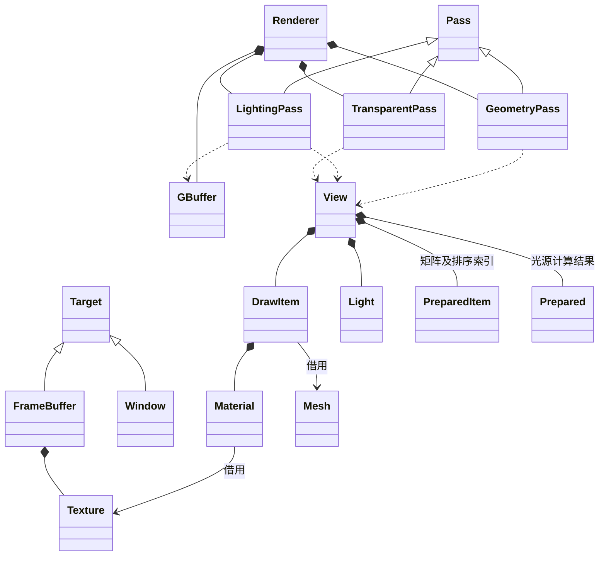

# Graphics 设计

本文描述当前实现及本次架构调整。代码位于 `runtime/Graphics`，公共类型位于 `Volcano::Graphics`，底层 OpenGL 封装位于 `gl`。

## 1. 模块边界与设计选择

Graphics 依赖 Base、World、Eigen、Freetype、HarfBuzz 和内置 gl3w；不依赖 Asset、Gui、GLFW 或窗口系统。不透明物体采用延迟光照，透明物体采用前向光照。内置路径要求 OpenGL 3.3，使用 GLSL 330 core。

Framework::Local 管理窗口、原生 OpenGL context 以及资源加载缓存；Launcher 管理事件和交换缓冲。Graphics 不激活 context，也不解析 Asset 文件；`Graphics::Model` 和 `View::Output` 运行时组件由调用方准备并挂载到 `World::Scene`，随后可由 `View::extract` 基于 EnTT 从 `World::Scene` 提取完整绘制视图（同时也保留 `View::begin/add/end` 供直接提交使用）。

本次调整落实如下：

| 项目 | 当前方案 | 原因 |
| --- | --- | --- |
| Context 访问接口 | 删除，Pass 显式接收准备好的 View，LightingPass 另接收 GBuffer | 各阶段没有访问整个 Renderer 的需要 |
| Texture 与输出目标 | Texture 仅管理纹理；FrameBuffer 实现 Target | 采样纹理无需 framebuffer 或深度附件 |
| Shader 定义 | Mesh、GBuffer、Light 提供自己的定义；具体 Pass 选择组合 | 基类无需知道任何特定渲染算法的接口 |
| 重复校验与计算 | View::begin/add/end 在提交前完成构建 | 复用本帧矩阵、光源计算及透明排序 |
| GBuffer 格式 | 保持 RGBA32F × 3 和 DEPTH_COMPONENT24 | 本轮不调整精度和存储布局 |
| 重复绑定及查询 | 每阶段绑定一次 Program；同尺寸 resize 提前返回；清屏使用已绑定输出 | 减少重复工作，不增加全局状态缓存 |

配置归所属对象管理，例如 `Renderer::setMaxLights()`。没有 RendererOptions、全局 ShaderInterface 或新的管理器。

## 2. 对象关系



Window 位于 Framework。Target 有实际多态调用；Pass 仅复用程序构建与参数位置解析，没有虚函数，构造和析构为 protected，不通过 Pass 指针执行或销毁派生对象。

## 3. 服务能力和成员数据

| 对象 | 提供的服务 | 内部成员及所有权 |
| --- | --- | --- |
| Renderer | render、renderVG、光源容量、字形图集预算及预热 | 直接持有 GBuffer、3D Pass 和 PaintPass（按声明顺序构造）；不保存当前 View/Target |
| View | begin/add/end 直接提交或通过 extract 从 `World::Scene` 提取渲染数据并计算矩阵、光源和透明排序，向 Renderer/Pass 提供只读结果 | vector<DrawItem>、vector<Light>、环境光/清屏色、两个 Matrix4f；两个 vector<PreparedItem>、vector<Light::Prepared>、State 枚举（Idle/Building/Ready） |
| Model | 保存预解析后的多 Part 非拥有 GPU 网格、默认材质与局部变换，作为客户端运行时渲染组件挂载到 `World::Scene` | `source` 路径、vector<Part>（借用 `const Mesh*`、`Material`、`Affine3f`、`transparent`） |
| View::Output | 为动态输出实体提供非拥有 `const Texture*` 绑定，供材质纹理槽位覆写提取时读取 | 借用 `const Texture*` |
| DrawItem | 描述一次网格绘制 | reference_wrapper<const Mesh>、Material、Eigen::Affine3f、transparent 标记 |
| View::PreparedItem | 关联原始绘制项并保存计算结果 | size_t index、Affine3f model、Matrix3f normal、float depth；不复制材质或 Mesh 引用 |
| Target | bind、width、height、size、contains | 输出绑定由 Window 或 FrameBuffer 实现，无额外回调状态 |
| Texture | RGBA8 纹理创建、上传、resize、尺寸查询 | gl::Texture2D、width/height；独占资源，可移动不可复制 |
| FrameBuffer | 离屏输出、resize、只读采样纹理访问 | Texture 颜色附件、gl::Renderbuffer 深度/模板附件、gl::Framebuffer |
| Mesh | 创建顶点/索引缓冲、shaderDefinitions、draw | gl::VertexArray、VertexBuffer、IndexBuffer、GLsizei 索引数量 |
| Material | 描述材质参数、apply 上传参数 | Colorf、借用 const Texture*、lit；Uniforms 缓存 shader 参数位置 |
| Light | validate、shaderSource | Type、RGB color、strength、position、direction、range、innerAngle/outerAngle |
| Light::Prepared | 校验并预计算单灯参数、apply 上传参数 | Type、radiance、position、归一化 direction、range、cone 余弦值；不借用原 Light |
| GBuffer | resize、shaderDefinitions、只读附件和尺寸查询 | 四张 gl::Texture2D、gl::Framebuffer、Size |
| Pass | attachShader 及共用参数位置解析 | gl::Program；嵌套 ObjectUniforms、LightingUniforms 类型，自身不分配缓存实例 |
| GeometryPass | 将不透明项写入 GBuffer | 继承 Program；一个 ObjectUniforms |
| LightingPass | 采样 GBuffer、全屏光照、写回不透明深度 | LightingUniforms、四个 sampler GLint、全屏绘制 VAO |
| TransparentPass | 按已排序列表执行前向光照与合成 | ObjectUniforms、LightingUniforms |

ObjectUniforms 缓存 projection/view/model/normalMatrix 和 Material::Uniforms；LightingUniforms 缓存 ambient/count 和 vector<Light::Uniforms>。它们只是所属程序的参数位置，不是全局配置，也不持有实际场景数据。位置在链接后解析一次，重新链接后必须重新解析。

## 4. 每帧准备和执行

调用方通过 `view.begin()` 开始构建，调用 add 添加数据，再调用 `view.end()` 完成构建，最后执行 `renderer.render(view, target)`。同一完成结果可以跨帧或输出到不同 Target，无需重复构建。

```cpp
view.begin();
view.add(mesh, material, transform, false);
view.add(light);
view.end();
renderer.render(view, window);
renderer.render(view, offscreen);
```

1. 调用方通过 begin/add/end 提交输入；end 检查环境光、灯光参数和有限矩阵，为每项计算 model，受光项计算逆转置 normal，为不透明项按纹理、lit、Mesh 稳定分组，为透明项计算相机空间深度并稳定排序。构建过程不调用 OpenGL。
2. Renderer 检查 View 已准备、光源数量符合自己的容量、材质纹理不属于本次 Target。目标宽或高非正时，完成这些检查后返回。
3. 使用宿主已绑定的 GL 函数表，按目标尺寸调整 GBuffer；同尺寸不查限值、不重新分配。
4. 绑定并清空输出颜色/深度；绑定 GBuffer，将三个颜色附件清零，深度清为 1。
5. GeometryPass 按 View 生成的状态分组顺序绘制不透明项：深度测试和写入开启，混合关闭。
6. 绑定输出，LightingPass 采样 GBuffer 计算 Lambert 光照，并通过 gl_FragDepth 传递不透明深度。无几何覆盖的像素保留清屏色。
7. TransparentPass 使用 View 中的排序结果，开启深度测试和预乘 alpha 混合，关闭深度写入。
8. 正常或异常退出均重新绑定本次输出，设置 viewport、深度写入和混合等 Renderer 约定状态。

View 自己维护计算结果和构建状态，不另建 Frame，不复制相机、材质或 Mesh 引用到第二份输入中。PreparedItem 通过原列表索引关联 DrawItem，View 复制后仍独立有效。begin/end 清空并复用内部 vector 容量。

非 const 接口供调用方构建，const 接口供 Renderer/Pass 查询，不回写、不隐式计算。items()/lights() 只返回 const vector&；add 按值保存材质和仿射矩阵、借用 Mesh，add 复制 Light，不返回可变内部引用。相机、环境光和清屏色使用 setProjection/setViewMatrix/setAmbientLight/setClearColor，按值保存输入。

| 状态 | 含义与合法操作 |
| --- | --- |
| Idle | 默认状态，或已完成后又修改相机/环境设置；不能渲染，须 begin 重新构建 |
| Building | begin 清空绘制项、灯光和计算缓存，保留相机/环境设置；允许 add 和 end |
| Ready | end 成功后可重复渲染，ready() 返回 true；添加数据或再次 end 违反调用前置条件，通过 Debug 断言检查 |

begin 可从任意状态开始，构建中再次 begin 会丢弃未完成提交。设置相机/环境参数可在 begin 前或构建期间进行；Ready 后调用 setter 会转为 Idle，须重新构建。end 失败保持 Building；缓存查询和渲染要求 Ready，Debug 下通过断言检查，不允许使用部分结果；可修正相机/环境设置后重试，或 begin 后重新添加输入。没有独立的 prepare 接口。

Mesh 和 Texture 仍由外部持有，在 View 用于绘制期间必须有效。渲染期间禁止并发修改 View 或资源。

两个受光程序有各自的 uniform 状态，仍须分别上传同一份 Prepared 光源；复用的是校验、方向归一化、颜色乘强度和角度余弦计算。直接执行 Pass 时也使用同一个准备好的 View。

输入构建由调用方在 render 前通过 end 完成；Renderer 在 Debug 下断言准备状态与输出反馈；容量校验和 GBuffer 扩容仍在运行时执行，均在清屏前完成，失败保留输出像素。实际绘制开始后的像素不回滚，异常继续向调用方传播。恢复的是 Renderer 的约定状态，不是调用方原有 GL 状态。

## 5. Texture、FrameBuffer 与 GBuffer

Texture 仅分配 RGBA8 二维纹理，检查 GL_MAX_TEXTURE_SIZE；不再受 renderbuffer 尺寸上限约束。上传要求紧密排列、底行在前的 `width * height * 4` 个 straight RGBA 字节，内部转换为预乘 alpha。纹理使用线性过滤和 CLAMP_TO_EDGE。

FrameBuffer 是一个具体 Target，持有 RGBA8 颜色 Texture 和 DEPTH24_STENCIL8 renderbuffer。`texture()` 返回 const Texture&，可供 Material 采样；不允许外部单独改变颜色附件尺寸。resize 先构造完整替代资源，成功后交换，失败保留旧资源。内部 Texture 对象地址不变，已有 Material 指针仍有效；底层 GL 标识可能改变。新分配内容未定义，使用前需清屏或上传。

Target::contains(texture) 默认 false；任何自定义纹理输出 Target 都必须覆盖此查询，报告其使用的 Graphics::Texture 附件，供 Debug 断言检查读写反馈。FrameBuffer 使用内部颜色对象身份判断。底层 GL 资源的别名和跨 context 误用不自动检测。Target::bind 只选择输出，Renderer 负责 viewport 和状态；内置渲染要求输出具备深度存储。

GBuffer 是专用中间资源，不派生 Target，也不与最终输出 FrameBuffer 合并：它有多附件布局和专门的 shader 约定。

| 附件 | 格式 | 内容 |
| --- | --- | --- |
| albedo，位置 0 | RGBA32F | 预乘材质颜色 |
| normal，位置 1 | RGBA32F | XYZ 世界法线，W 受光标记 |
| position，位置 2 | RGBA32F | 世界位置 |
| depth | DEPTH_COMPONENT24 | 不透明深度 |

这些格式本轮保持不变，无 MSAA，每像素约 52 字节，驱动实际占用可能不同。GBuffer 首次 resize 前没有存储；分配失败或非法尺寸保留原资源。

## 6. Shader 接口归属与扩展细节

Pass::attachShader(stage, version, source, definitions) 仅按 `#version → definitions → source` 组装并编译；source/definitions 不含 #version。它不判断 vertex/fragment，也不自动注入顶点、GBuffer 或颜色输出宏。

| 定义 | 所属对象 | 使用方 |
| --- | --- | --- |
| POSITION/NORMAL/TEXCOORD_ATTRIBUTE | Mesh::shaderDefinitions()，位置 0/1/2 | 几何与透明顶点 shader |
| ALBEDO/NORMAL/POSITION_ATTACHMENT | GBuffer::shaderDefinitions()，位置 0/1/2 | 几何片元 shader |
| MAX_LIGHTS、灯光结构及算法 | Light::shaderSource(maxLights) | 光照与透明片元 shader |
| COLOR_OUTPUT | LightingPass、TransparentPass 各自私有常量，值为 0 | 对应片元 shader |
| GBuffer 采样纹理单元 0/1/2/3 | LightingPass 私有常量 | 光照片元 shader |
| 材质纹理单元 0 | Material 私有常量 | 材质 apply |

具体 Pass 明确选择需要的定义：

```cpp
attachShader(GL_VERTEX_SHADER, "330 core", vertexSource, Mesh::shaderDefinitions());
attachShader(GL_FRAGMENT_SHADER, "330 core", fragmentSource, GBuffer::shaderDefinitions());
program_.link();
```

自定义 Pass 可以不传这些定义，也可以附加 geometry、tessellation 或 compute shader，版本和阶段组合由当前 OpenGL context 支持。OpenGL 3.3 最低要求不保证 compute/tessellation 可用。派生类负责 link、接口校验以及自己的 uniform 缓存；无需增加统一 ShaderInterface 对象。

每个内置 Pass 链接时检查所需 uniform 类型/容量、attribute 位置/类型及片元输出位置。每次 render 只调用一次 program_.use()；物体循环只更新物体参数、材质并提交 Mesh。GeometryPass 和 TransparentPass 通过 ScopeGuard 保证退出时解绑程序。

`gl::Program` 提供：

- uniformLocation(name)，以及带 type/minimumCount/required 的校验重载；可选缺失返回 -1，存在时仍须匹配类型和容量。
- attributeLocation 的查询和类型/位置校验。
- fragmentLocation(name) 封装 glGetFragDataLocation，缺失返回 -1；带 expectedLocation 的重载在不匹配时抛异常。它对应 draw buffer 索引，由 framebuffer 的 draw buffers 映射到附件。
- uniform(GLint/GLuint/GLfloat)、uniform2f/3f/4f、uniformMatrix3fv/4fv 均支持名字和缓存 GLint 位置；按位置上传不重复查询，也不自动绑定程序。sampler 单元必须用 GLint，不能使用 GLuint 上传。

这里的完整封装范围是现有上传接口的名字/位置两种用法，没有新增所有 OpenGL 版本的全部 uniform 类型。

## 7. 顶点、光照和透明约定

Mesh::Vertex 是交错格式：position 为 float[3]、normal 为 float[3]、texcoord 为 float[2]；索引为 uint32_t，绘制 GL_TRIANGLES。C++ 使用 std::array 保存各字段，上传步长和偏移通过 sizeof/offsetof 获取，不要求调用方手写字节偏移。

Material 保存乘法色、可选 Texture 指针和 lit 开关。lit 默认 false；启用时采用世界空间 Lambert 漫反射。DrawItem 保存完整 Eigen::Affine3f，可保留剪切；add 的 Transform 重载通过 affine() 转换，非有限 TRS 在添加时即报错，仿射矩阵在 end 时校验；Eigen::normalMatrix(affine) 计算逆转置并检查有限性和可逆性，Transform::normalMatrix() 复用该函数。非受光项无需可逆法线变换。

环境光、灯光颜色和强度为有限非负值。方向指向光传播方向；局部灯光 range 必须有限且为正。点光/聚光衰减为 max(1-distance/range, 0)²；聚光内外半角以度表示，0 ≤ inner < outer ≤ 90，余弦须可区分，边缘使用 smoothstep。

Renderer 光源容量默认 16，setMaxLights(count) 原子替换两个受光 Pass：相同容量直接返回，非法容量或编译失败保留原程序与容量。独立 Pass 在构造时指定容量。Renderer 与受光 Pass 都检查自己的容量，超限抛异常，不截断；View::end 不绑定任何 Renderer 或光源容量。

不透明项在 end 中按“Texture 对象身份 → Material::lit → Mesh 对象身份”稳定排序，使用 std::less 比较资源指针，不读取 GL 标识。颜色和模型矩阵不参与排序，相同键保留提交顺序。排序仅调整 PreparedItem 列表，items() 保留原始提交顺序。不同状态的不透明项不保证提交先后顺序；共面且深度相同的物体可能改变遮挡结果，调用方应避免依赖提交顺序处理此类重叠。

当前只生成分组顺序，Pass 仍逐项上传材质并绑定纹理、Mesh；本轮没有加入重复状态跳过、批处理或实例化，也未承诺减少 GL 调用次数。

透明分类由 DrawItem::transparent 显式指定。相机朝局部 -Z，按模型原点的相机空间 Z 从小到大稳定排序；不改变 View 原列表。此方法不能解决穿插网格或网格内部透明三角形排序。颜色采用预乘 alpha 合成，不自动进行 sRGB 转换。

当前没有阴影、PBR、镜面反射、法线贴图、HDR 色调映射或自动 World 场景提取。

## 8. 生命周期、迁移与验证

创建、使用和析构所有 GPU 对象前，调用方必须激活正确的原生 OpenGL context，并保证对应 context 的 GL3W 函数表已初始化并绑定。Renderer 和所有外部 GPU 资源都须先于所属原生 context 及函数表销毁；外部资源不依赖 Renderer 的生命周期。

Graphics 不初始化、持有或切换 GL3W 函数表。Framework::Window 在创建并激活窗口 context 后加载 GL3W、校验 OpenGL 3.3，并按值持有函数表；makeCurrent 同时选择 context 和函数表，析构时清除指向自身的全局分派指针。其它宿主（如 Qt 编辑器）负责相同的初始化和生命周期。Renderer 无参构造，GPU 成员按声明顺序构造并逆序销毁。gl3w 仍使用全局分派指针，当前不支持并发渲染。

迁移方式：

- 原来用于 render 输出的 Texture 改为 FrameBuffer；材质引用 `&buffer.texture()`。纯采样 Texture 的创建和 upload 保持原用法。
- 删除 Context 实现及 Renderer::view()/target() 调用。调用方通过 begin/add/end 完成构建，再向 Renderer 或独立阶段显式传入 const View&。
- GeometryPass::render(view)、TransparentPass::render(view)、LightingPass::render(view, geometry)。调用方负责绑定 framebuffer、设置 viewport 和清屏；LightingPass 检查 GBuffer 已分配、输出不是输入、viewport 匹配。
- 自定义 Pass 显式传入所属对象的 shaderDefinitions；不再依赖基类自动注入宏。

无显示测试覆盖函数加载、容量和非法输入、Texture/FrameBuffer 职责拆分、resize 失败回滚、View 构建时序、失败恢复、缓存重建、复制独立性和排序、Prepared 光源上传。真实 GLFW/OpenGL 集成测试覆盖像素、阶段组合、接口校验、输出反馈和状态恢复，带 display 标签。

```sh
cmake --build build/eigen --target GraphicsLoaderCheck GraphicsLightingCheck FrameworkWindowCheck Launcher Editor BaseMathCheck BaseTransformCheck -j2
ctest --test-dir build/eigen -R 'GraphicsLoader|GraphicsLighting|GraphicsResources|BaseMath|BaseTransform' --output-on-failure
# 有显示服务及 OpenGL 3.3 时运行像素集成测试
ctest --test-dir build/eigen -L display --output-on-failure
```

## VG、字体与动态纹理

参见 [VG 与世界动态纹理设计](VG.md)。

## OpenGL 集成与字体

Graphics 直接使用 OpenGL，不增加后端隔离层，不使用 PImpl；成员数据直接保存在所属对象中。Font 的公开头文件直接包含 FreeType/HarfBuzz 类型，其依赖由 Graphics 公开传递。通用 GL 对象由 GL/gl.hpp 封装；Mesh::draw、Texture::texture、Target::bind 和 Renderer::geometryBuffer 提供各对象自己的操作或资源访问。Material 与 Light::Prepared 通过 apply 上传参数，对应 Uniforms 缓存由 Pass 持有。

Graphics::Font 拥有字体字节、FreeType/HarfBuzz 对象，CPU 测量与塑形无需 GL。Framework 负责读取并缓存 Font，Graphics 的 Renderer 管理 GPU 字形图集及淘汰。Gui 仅通过 Context 请求文字测量和绘制。

Canvas 只记录 VG 内容，不持有输出纹理。View::add 在场景之前执行输出任务，add 在场景之后合成；任务引用的命令、字体、图片和目标必须存活至执行完成。详细能力及限制见 VG.md。
